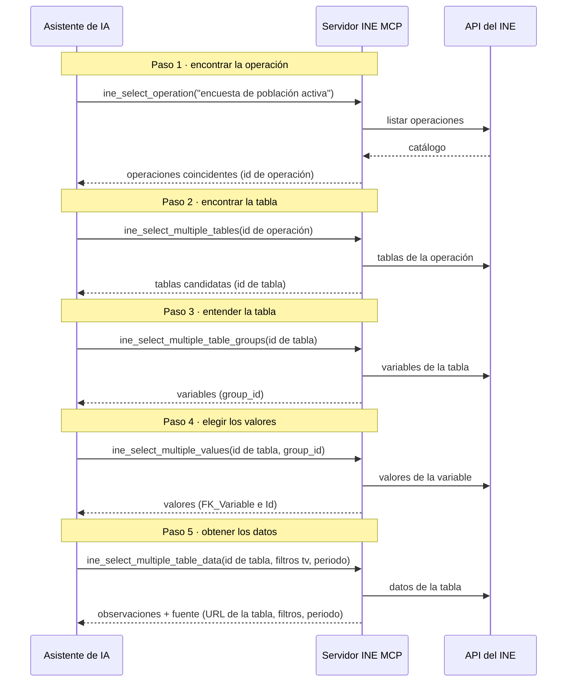

<div align="center">

# INE MCP

**Estadísticas oficiales de España, directamente desde la fuente, para cualquier asistente de IA.**

Un servidor del [Model Context Protocol](https://modelcontextprotocol.io) para la API JSON pública del
**INE** (Instituto Nacional de Estadística / Statistics Spain).

[](https://www.python.org/)
[](https://modelcontextprotocol.io)

[](LICENSE.md)


[Inicio rápido](#inicio-rápido) ·
[Conectar un cliente](#conectar-un-cliente) ·
[Herramientas disponibles](#herramientas-disponibles) ·
[Operaciones disponibles](#operaciones-disponibles)

[Inglés](README.md) · **Español**

</div>

---

Da a tu asistente de IA acceso directo a las estadísticas oficiales del INE.

Este servidor permite que cualquier cliente MCP (Claude, Codex, Cursor, VS Code, Windsurf, Gemini CLI, Zed y otros) consulte la API JSON pública del **INE** (Instituto Nacional de Estadística, Statistics Spain). Pregunta en lenguaje natural, por ejemplo *"¿Cuál fue la tasa de paro de los hombres en Murcia en los últimos cuatro trimestres?"*, y el asistente encontrará la operación estadística adecuada, elegirá la tabla, resolverá los filtros y responderá con las cifras y un enlace a la tabla oficial del INE.

| | |
| --- | --- |
| **Endpoint alojado** | Disponible próximamente (mientras tanto, [ejecútalo en local](#ejecutar-en-local)) |
| **Transporte** | `stdio` (por defecto) o Streamable HTTP |
| **Autenticación** | Ninguna, los datos son públicos |
| **Cobertura** | España y sus desgloses territoriales (comunidades autónomas, provincias, municipios…) |
| **Idioma** | Descripciones de las herramientas en inglés; etiquetas de los datos en español, tal como las publica el INE |
| **Catálogo** | 166 operaciones, 110 con tablas disponibles hoy ([lista completa](Resources/Catalogue.es.md)) |

**Por qué usarlo**

- **Datos reales, no memoria.** Cada cifra se obtiene de la API del INE en el momento de la consulta.
- **Un camino guiado.** Hay que llamar a cinco herramientas en orden; el servidor rechaza los pasos omitidos y los identificadores que no ha devuelto él mismo.
- **Siempre con fuente.** Cada resultado incluye la operación, la tabla, su URL pública y los filtros aplicados.
- **Rápido.** Cada paso admite varias peticiones a la vez y las resuelve en paralelo.

## Contenido

- [Inicio rápido](#inicio-rápido)
- [Instalación](#instalación)
  - [Servidor alojado](#servidor-alojado)
  - [Ejecutar en local](#ejecutar-en-local)
  - [Conectar un cliente](#conectar-un-cliente)
- [Preguntas de ejemplo](#preguntas-de-ejemplo)
- [Herramientas disponibles](#herramientas-disponibles)
  - [Orden obligatorio](#orden-obligatorio)
- [Operaciones disponibles](#operaciones-disponibles)
- [Desarrollo](#desarrollo)
- [Solución de problemas](#solución-de-problemas)
- [Limitaciones](#limitaciones)
- [Privacidad](#privacidad)
- [Fuente de los datos y atribución](#fuente-de-los-datos-y-atribución)
- [Enlaces](#enlaces)
- [Trabajo en curso y aviso legal](#trabajo-en-curso-y-aviso-legal)
  - [Trabajo en curso](#trabajo-en-curso)
  - [Aviso legal](#aviso-legal)
- [Mantenimiento del paquete y contribuciones](#mantenimiento-del-paquete-y-contribuciones)
- [Licencia](#licencia)

## Inicio rápido

1. Instala [`uv`](https://docs.astral.sh/uv/) y clona el repositorio ([detalles](#ejecutar-en-local)).
2. Registra el servidor en tu cliente, por ejemplo con Claude Code:

   ```bash
   claude mcp add ine -- uv run --directory /path/to/ine-mcp ine-mcp
   ```

3. Haz una pregunta: *"Dame las últimas cuatro tasas trimestrales de paro de los hombres en Murcia."*

## Instalación

Hay dos formas de usar el servidor: el endpoint alojado (**disponible próximamente**) o una
copia local ejecutándose en tu máquina. La instalación local está disponible hoy.

### Servidor alojado

> **Disponible próximamente.** Todavía no se ha publicado un endpoint público. Cuando se publique,
> esta sección incluirá la URL y los fragmentos de configuración para cada cliente.

| | |
| --- | --- |
| **Endpoint** | *Disponible próximamente* |
| **Transporte** | Streamable HTTP |
| **Autenticación** | Ninguna |

### Ejecutar en local

**Requisitos:** Python 3.11 o superior y [`uv`](https://docs.astral.sh/uv/).

```bash
git clone https://github.com/es-ine/mcp.git ine-mcp
```

```bash
cd ine-mcp
```

Con `uv`:

```bash
uv sync
```

```bash
uv run ine-mcp
```

El servidor arranca con el transporte `stdio` y espera a un cliente MCP. No muestra nada hasta que se conecta un cliente; es lo esperado.

Para actualizar un clon existente, ejecuta `git pull` y después `uv sync` de nuevo.

### Conectar un cliente

En los fragmentos siguientes, sustituye `/path/to/ine-mcp` por la ruta absoluta de tu clon.

#### Clientes de línea de comandos (una línea)

| Cliente | Comando |
| --- | --- |
| Claude Code | `claude mcp add ine -- uv run --directory /path/to/ine-mcp ine-mcp` |
| Codex (OpenAI) | `codex mcp add ine -- uv run --directory /path/to/ine-mcp ine-mcp` |
| VS Code | `code --add-mcp '{"name":"ine","command":"uv","args":["run","--directory","/path/to/ine-mcp","ine-mcp"]}'` |

#### Clientes con un fichero JSON

La mayoría de los clientes leen el mismo bloque. Pégalo en el fichero de tu cliente y reinícialo:

```json
{
	"mcpServers": {
		"ine": {
			"command": "uv",
			"args": ["run", "--directory", "/path/to/ine-mcp", "ine-mcp"]
		}
	}
}
```

| Cliente | Fichero de configuración |
| --- | --- |
| Claude Desktop (macOS) | `~/Library/Application Support/Claude/claude_desktop_config.json` |
| Claude Desktop (Windows) | `%APPDATA%\Claude\claude_desktop_config.json` |
| Claude Desktop (Microsoft Store) | `%LOCALAPPDATA%\Packages\Claude_pzs8sxrjxfjjc\LocalCache\Roaming\Claude\claude_desktop_config.json` |
| Cursor | `~/.cursor/mcp.json` (global) o `.cursor/mcp.json` (proyecto) |
| Windsurf | `~/.codeium/windsurf/mcp_config.json` |
| Gemini CLI | `~/.gemini/settings.json` |
| Cline, LM Studio y otros | El fichero de ajustes MCP del cliente (mismo bloque `mcpServers`) |

Algunos clientes usan un formato distinto:

<details>
<summary>VS Code (<code>.vscode/mcp.json</code>): clave <code>servers</code> y un <code>type</code></summary>

```json
{
	"servers": {
		"ine": {
			"type": "stdio",
			"command": "uv",
			"args": ["run", "--directory", "/path/to/ine-mcp", "ine-mcp"]
		}
	}
}
```

</details>

<details>
<summary>Codex (<code>~/.codex/config.toml</code>): TOML en lugar de JSON</summary>

```toml
[mcp_servers.ine]
command = "uv"
args = ["run", "--directory", "/path/to/ine-mcp", "ine-mcp"]
```

</details>

## Preguntas de ejemplo

- "¿Cuál fue la tasa del IPC en Madrid durante el último año?"
- "Busca la operación estadística del INE para la Encuesta de Población Activa."
- "¿Qué tablas de la Encuesta de Población Activa desglosan el paro por grupo de edad o sexo?"
- "Dame las últimas cuatro tasas trimestrales de paro de los hombres en Murcia."
- "¿Cuántas personas viven en cada provincia, según las últimas cifras?"

## Herramientas disponibles

El servidor expone cinco herramientas de solo lectura. Están pensadas para llamarse en orden, y cada una acepta un lote de peticiones que resuelve en paralelo.

| Paso | Herramienta | Descripción |
| --- | --- | --- |
| 1 | `ine_select_operation` | Busca en el catálogo de operaciones estadísticas (IPC, Encuesta de Población Activa, PIB…) por nombre y descripción. |
| 2 | `ine_select_multiple_tables` | Lista las tablas de una o varias operaciones, con filtro opcional por términos de búsqueda. |
| 3 | `ine_select_multiple_table_groups` | Devuelve las variables (grupos) que estructuran una o varias tablas. |
| 4 | `ine_select_multiple_values` | Devuelve los valores de las variables elegidas, por ejemplo las provincias o las categorías de sexo. |
| 5 | `ine_select_multiple_table_data` | Extrae las observaciones, filtradas por pares `tv` y un periodo. |

Cómo usa las herramientas (caso sencillo):



Cada paso solo acepta identificadores devueltos por los anteriores; si se omite un paso, el servidor responde `BLOCKED`.

Las cinco herramientas están anotadas con `readOnlyHint` y `openWorldHint`. Las cuatro primeras están además marcadas como idempotentes.

### Orden obligatorio

La secuencia se comprueba en código y la comprobación no se puede desactivar. Una llamada que llega demasiado pronto devuelve un error que empieza por `BLOCKED`, indica el paso que falta y dice a qué herramienta llamar a continuación.

| Paso | Se acepta solo si |
| --- | --- |
| 2 | El ID o código de la operación existe en el catálogo de operaciones. |
| 3 | La tabla fue devuelta por el paso 2. |
| 4 | Las variables de la tabla se consultaron en el paso 3 y `group_id` es una de ellas. |
| 5 | Los pasos 2 a 4 están completos para la tabla, y cada filtro `tv` está bien formado y coincide con un valor devuelto por el paso 4. |

## Operaciones disponibles

El catálogo contiene **166** operaciones estadísticas del INE. **110** ya tienen tablas y funcionan de extremo a extremo; las otras **56** están listadas y serán utilizables cuando el INE publique sus tablas.

Consulta [`Resources/Catalogue.es.md`](Resources/Catalogue.es.md) para ver la tabla completa de operaciones disponibles ahora y próximamente, además de un glosario.

## Desarrollo

El servidor es un paquete pequeño en `src/ine_mcp/`:

| Fichero | Función |
| --- | --- |
| `server.py` | Punto de entrada (`ine-mcp`) y selección del transporte. |
| `tools.py` | La instancia del servidor MCP y las cinco herramientas. |
| `state.py` | Estado del flujo por sesión y validación del orden de los cinco pasos y de los filtros `tv`. |
| `client.py`, `cache.py` | Cliente HTTP de la API del INE y caché TTL en memoria. |
| `models.py`, `utils.py`, `config.py` | Modelos de entrada, filtrado de respuestas y configuración. |

`Resources/ine_mcp_instructions.md` es la guía de uso que el servidor envía al cliente; está incluida en el paquete.

Ejecuta las pruebas:

```bash
uv run pytest
```

## Solución de problemas

| Síntoma | Solución |
| --- | --- |
| El servidor no aparece en el cliente | Comprueba que `/path/to/ine-mcp` es una ruta absoluta y reinicia el cliente por completo. |
| Una operación no devuelve tablas | Está en la lista de *próximamente* de [Resources](Resources/Catalogue.es.md#próximamente). |
| Respuestas vacías o con error | La API del INE puede no estar disponible temporalmente; inténtalo de nuevo más tarde. |

## Limitaciones

- Los datos dependen de la API pública del INE; la disponibilidad y los tiempos de respuesta son los del INE.
- Las etiquetas están en español e inglés, tal como las publica el INE.
- Las herramientas son de solo lectura: el servidor nunca escribe ni modifica nada.
- Solo las operaciones con tablas publicadas pueden devolver datos.
- El endpoint alojado todavía no está disponible; usa la instalación local.

## Privacidad

No se necesita autenticación ni datos personales. El servidor solo reenvía a la API pública del INE las consultas necesarias para responder a tu pregunta.

## Fuente de los datos y atribución

Los datos los publica el [Instituto Nacional de Estadística](https://www.ine.es) y se sirven a través de su [API JSON](https://www.ine.es/dyngs/DAB/index.htm?cid=1099) pública. Si reutilizas las cifras, cita al INE como fuente y enlaza la URL de la tabla devuelta con cada resultado.

## Enlaces

- [Model Context Protocol](https://modelcontextprotocol.io)
- [Documentación de la API JSON del INE](https://www.ine.es/dyngs/DAB/index.htm?cid=1099)
- [Catálogo de operaciones y referencia](Resources/Catalogue.es.md)

## Trabajo en curso y aviso legal

### Trabajo en curso

Este proyecto está en desarrollo activo.

### Aviso legal

Este repositorio y su contenido se ofrecen únicamente con fines informativos y técnicos.
El uso de este código es responsabilidad de quien lo utiliza.

El Instituto Nacional de Estadística proporciona este software **"tal cual"**, sin garantía de ningún tipo, ni expresa ni implícita.

Al usar este repositorio, aceptas que:
- Eres responsable de revisar y probar el código antes de usarlo en cualquier entorno de producción o crítico.
- El Instituto Nacional de Estadística **no se hace responsable** de ningún daño directo, indirecto o consecuente derivado del uso de este software.

## Mantenimiento del paquete y contribuciones

Cualquier contribución es bienvenida y debe hacerse mediante pull requests o incidencias (issues). Las pull requests deben incluir pruebas y documentación actualizadas. Si cambia la funcionalidad, hay que añadir o actualizar los docstrings.

## Licencia

El código de este proyecto se publica bajo la [Licencia Pública de la Unión Europea v. 1.2 (EUPL-1.2)](LICENSE.md).
