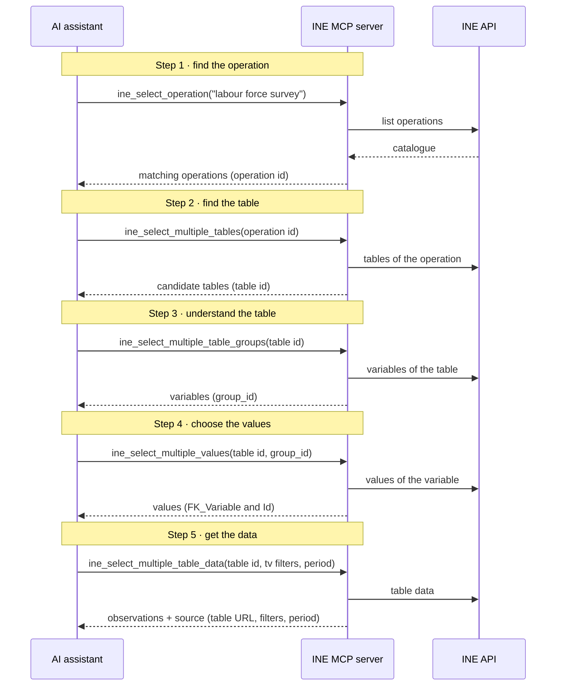

<div align="center">

# INE MCP

**Official statistics of Spain, straight from the source, for any AI assistant.**

A [Model Context Protocol](https://modelcontextprotocol.io) server for the public JSON API of
**INE** (Instituto Nacional de Estadística / Statistics Spain).

[](https://www.python.org/)
[](https://modelcontextprotocol.io)

[](LICENSE.md)


[Quick start](#quick-start) ·
[Connect a client](#connect-a-client) ·
[Available tools](#available-tools) ·
[Available operations](#available-operations)

**English** · [Spanish](README.es.md)

</div>

---

Give your AI assistant direct access to Statistics Spain's official statistics.

This server lets any MCP client (Claude, Codex, Cursor, VS Code, Windsurf, Gemini CLI, Zed and others) query the public JSON API of the **INE** (Instituto Nacional de Estadística, Statistics Spain). Ask in plain language, for example *"What was the unemployment rate for men in Murcia over the last four quarters?"*, and the assistant will find the right statistical operation, choose the table, resolve the filters and answer with the figures and a link to the official INE table.

| | |
| --- | --- |
| **Hosted endpoint** | Available soon (meanwhile, [run it locally](#run-locally)) |
| **Transport** | `stdio` (default) or Streamable HTTP |
| **Authentication** | None, the data is public |
| **Coverage** | Spain and its territorial breakdowns (autonomous communities, provinces, municipalities…) |
| **Language** | Tool descriptions in English; data labels in Spanish, as INE publishes them |
| **Catalogue** | 166 operations, 110 with tables available today ([full list](Resources/Catalogue.md)) |

**Why use it**

- **Real data, not memory.** Every figure is fetched from INE's API at request time.
- **A guided path.** Five tools must be called in order; the server rejects skipped steps and identifiers it never returned.
- **Always sourced.** Each result includes the operation, the table, its public URL and the filters applied.
- **Quick.** Every step takes several requests at once and resolves them in parallel.

## Contents

- [Quick start](#quick-start)
- [Installation](#installation)
  - [Hosted server](#hosted-server)
  - [Run locally](#run-locally)
  - [Connect a client](#connect-a-client)
- [Example questions](#example-questions)
- [Available tools](#available-tools)
  - [Enforced order](#enforced-order)
- [Available operations](#available-operations)
- [Development](#development)
- [Troubleshooting](#troubleshooting)
- [Limitations](#limitations)
- [Privacy](#privacy)
- [Data source and attribution](#data-source-and-attribution)
- [Links](#links)
- [WIP and disclaimer](#wip-and-disclaimer)
  - [Work in progress](#work-in-progress)
  - [Disclaimer](#disclaimer)
- [Package maintenance and contributing](#package-maintenance-and-contributing)
- [Licensing](#licensing)

## Quick start

1. Install [`uv`](https://docs.astral.sh/uv/) and clone the repository ([details](#run-locally)).
2. Register the server in your client, for example with Claude Code:

   ```bash
   claude mcp add ine -- uv run --directory /path/to/ine-mcp ine-mcp
   ```

3. Ask a question: *"Give me the last four quarterly unemployment rates for men in Murcia."*

## Installation

Two ways to use the server: the hosted endpoint (**available soon**) or a local
copy running on your machine. The local setup is available today.

### Hosted server

> **Available soon.** A public endpoint has not been published yet. Once it is,
> this section will list the URL and the configuration snippets for each client.

| | |
| --- | --- |
| **Endpoint** | *Available soon* |
| **Transport** | Streamable HTTP |
| **Authentication** | None |

### Run locally

**Requirements:** Python 3.11 or later, and [`uv`](https://docs.astral.sh/uv/).

```bash
git clone https://gitlab.ine.es/prod-estadistica/metodologia/ia-ready/mcp.git ine-mcp
```

```bash
cd ine-mcp
```

With `uv`:

```bash
uv sync
```

```bash
uv run ine-mcp
```

The server starts on the `stdio` transport and waits for an MCP client. It prints nothing until a client connects; that is expected.

To update an existing clone, run `git pull` and then `uv sync` again.

### Connect a client

In the snippets below, replace `/path/to/ine-mcp` with the absolute path of your clone.

#### Command-line clients (one line)

| Client | Command |
| --- | --- |
| Claude Code | `claude mcp add ine -- uv run --directory /path/to/ine-mcp ine-mcp` |
| Codex (OpenAI) | `codex mcp add ine -- uv run --directory /path/to/ine-mcp ine-mcp` |
| VS Code | `code --add-mcp '{"name":"ine","command":"uv","args":["run","--directory","/path/to/ine-mcp","ine-mcp"]}'` |

#### Clients with a JSON file

Most clients read the same block. Paste it into the file for your client and restart it:

```json
{
	"mcpServers": {
		"ine": {
			"command": "uv",
			"args": ["run", "--directory", "/path/to/ine-mcp", "ine-mcp"]
		}
	}
}
```

| Client | Configuration file |
| --- | --- |
| Claude Desktop (macOS) | `~/Library/Application Support/Claude/claude_desktop_config.json` |
| Claude Desktop (Windows) | `%APPDATA%\Claude\claude_desktop_config.json` |
| Claude Desktop (Microsoft Store) | `%LOCALAPPDATA%\Packages\Claude_pzs8sxrjxfjjc\LocalCache\Roaming\Claude\claude_desktop_config.json` |
| Cursor | `~/.cursor/mcp.json` (global) or `.cursor/mcp.json` (project) |
| Windsurf | `~/.codeium/windsurf/mcp_config.json` |
| Gemini CLI | `~/.gemini/settings.json` |
| Cline, LM Studio and others | The client's MCP settings file (same `mcpServers` block) |

Some clients use a different format:

<details>
<summary>VS Code (<code>.vscode/mcp.json</code>): key <code>servers</code> and a <code>type</code></summary>

```json
{
	"servers": {
		"ine": {
			"type": "stdio",
			"command": "uv",
			"args": ["run", "--directory", "/path/to/ine-mcp", "ine-mcp"]
		}
	}
}
```

</details>

<details>
<summary>Codex (<code>~/.codex/config.toml</code>): TOML instead of JSON</summary>

```toml
[mcp_servers.ine]
command = "uv"
args = ["run", "--directory", "/path/to/ine-mcp", "ine-mcp"]
```

</details>

## Example questions

- "What was the CPI rate in Madrid over the last year?"
- "Find the INE statistical operation for the Labour Force Survey."
- "Which Labour Force Survey tables break unemployment down by age group or sex?"
- "Give me the last four quarterly unemployment rates for men in Murcia."
- "How many people live in each province, according to the latest figures?"

## Available tools

The server exposes five read-only tools. They are meant to be called in order, and each one accepts a batch of requests that it resolves in parallel.

| Step | Tool | Description |
| --- | --- | --- |
| 1 | `ine_select_operation` | Searches the catalogue of statistical operations (CPI, Labour Force Survey, GDP…) by name and description. |
| 2 | `ine_select_multiple_tables` | Lists the tables of one or more operations, optionally filtered by search terms. |
| 3 | `ine_select_multiple_table_groups` | Returns the variables (groups) that structure one or more tables. |
| 4 | `ine_select_multiple_values` | Returns the values of the chosen variables — for example, the provinces or the sex categories. |
| 5 | `ine_select_multiple_table_data` | Extracts the observations, filtered by `tv` pairs and a period. |

How it uses the tools (simple case):



Each step only accepts identifiers returned by the previous ones; if a step is skipped, the server answers `BLOCKED`.

All five tools are annotated `readOnlyHint` and `openWorldHint`. The first four are also marked idempotent.

### Enforced order

The sequence is checked in code, and the check cannot be switched off. A call that arrives too early returns an error that starts with `BLOCKED`, names the missing step and says what to call next.

| Step | Accepted only if |
| --- | --- |
| 2 | The operation ID or code exists in the operations catalogue. |
| 3 | The table was returned by step 2. |
| 4 | The table's variables were queried in step 3 and `group_id` is one of them. |
| 5 | Steps 2 to 4 are complete for the table, and every `tv` filter is well formed and matches a value returned by step 4. |

## Available operations

The catalogue holds **166** INE statistical operations. **110** already have tables and work end to end; the other **56** are listed and will be usable once INE publishes their tables.

See [`Resources/Catalogue.md`](Resources/Catalogue.md) for the complete table of operations available now and coming soon, plus a glossary.

## Development

The server is a small package under `src/ine_mcp/`:

| File | Role |
| --- | --- |
| `server.py` | Entry point (`ine-mcp`) and transport selection. |
| `tools.py` | The MCP server instance and the five tools. |
| `state.py` | Per-session flow state and validation of the five-step order and `tv` filters. |
| `client.py`, `cache.py` | HTTP client for the INE API and in-memory TTL cache. |
| `models.py`, `utils.py`, `config.py` | Input models, response filtering and configuration. |

`Resources/ine_mcp_instructions.md` is the usage guide the server sends to the client; it is bundled into the package.

Run the tests:

```bash
uv run pytest
```

## Troubleshooting

| Symptom | Fix |
| --- | --- |
| The server does not appear in the client | Check that `/path/to/ine-mcp` is absolute, then restart the client completely. |
| An operation returns no tables | It is in the *coming soon* list of [Resources](Resources/Catalogue.md#coming-soon). |
| Empty or failing responses | The INE API may be temporarily unavailable; try again later. |

## Limitations

- Data depends on the INE public API; availability and response times are INE's.
- Labels are in Spanish and English, as INE publishes them.
- Tools are read-only: the server never writes or modifies anything.
- Only operations with published tables can return data.
- The hosted endpoint is not available yet; use the local setup.

## Privacy

No authentication and no personal data are needed. The server only forwards the queries required to answer your question to the public INE API.

## Data source and attribution

The data is published by the [Instituto Nacional de Estadística](https://www.ine.es) and served through its public [JSON API](https://www.ine.es/dyngs/DAB/index.htm?cid=1099). When you reuse the figures, cite INE as the source and link to the table URL returned with each result.

## Links

- [Model Context Protocol](https://modelcontextprotocol.io)
- [INE JSON API documentation](https://www.ine.es/dyngs/DAB/index.htm?cid=1099)
- [Operations catalogue and reference](Resources/Catalogue.md)

## WIP and disclaimer

### Work in progress

This project is currently under active development.

### Disclaimer

This repository and its contents are provided for informational and technical purposes only.  
Use of this code is at your own risk.

The Instituto Nacional de Estadística (Spanish Statistical Office) provides this software **"as is"**, without warranty of any kind, either expressed or implied.

By using this repository, you acknowledge that:
- You are responsible for reviewing and testing the code before using it in any production or critical environment.
- The Instituto Nacional de Estadística is **not liable** for any direct, indirect, or consequential damages arising from the use of this software.

## Package maintenance and contributing

Any contribution is welcome and should be done through pull requests and/or issues. Pull requests should include updated tests and updated documentation. If functionality is changed, docstrings should be added or updated.

## Licensing

The code of this project is licensed under the [European Union Public Licence v. 1.2 (EUPL-1.2)](LICENSE.md).
